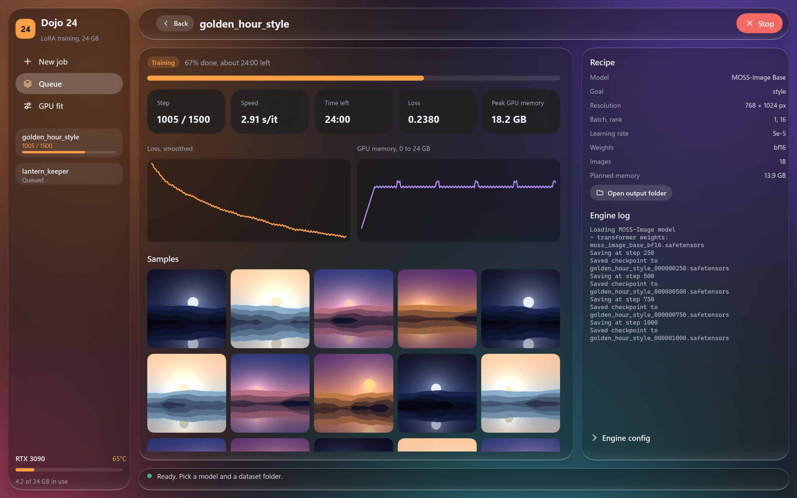
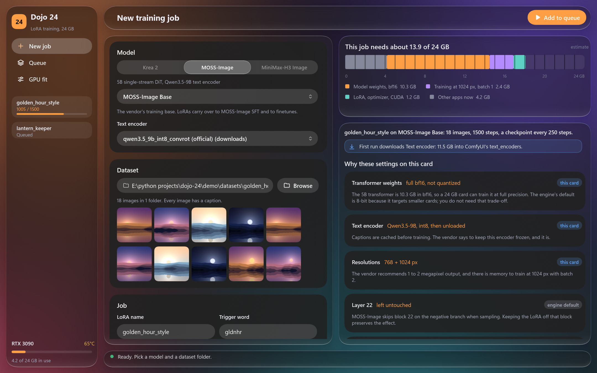
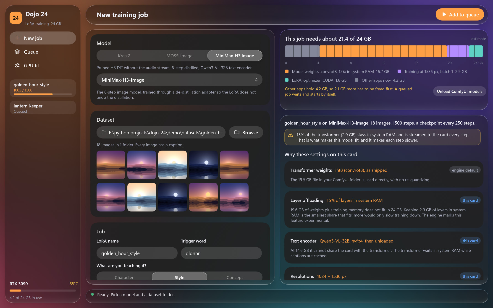
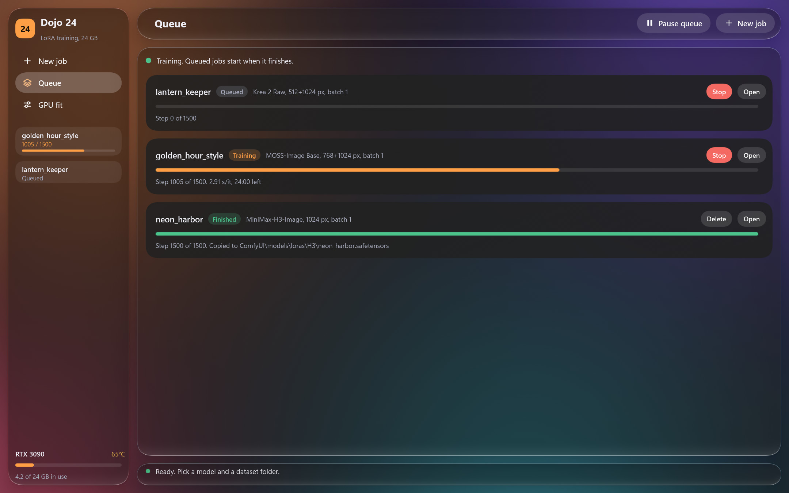
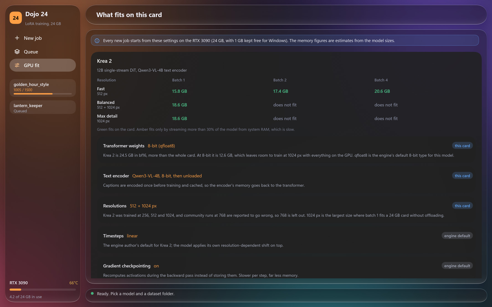

<div align="center">

# Dojo 24

**LoRA training for Krea 2, MOSS-Image and MiniMax-H3 Image, planned for a 24 GB GPU.**

A native Windows app in Rust with a Liquid Glass interface ([rust-glass](https://crates.io/crates/rust-glass)),
running [ostris/ai-toolkit](https://github.com/ostris/ai-toolkit) underneath.


-76B900?style=flat-square&logo=nvidia)




</div>

Dojo 24 knows three models and one card. Before a job starts, it works out how the model
fits in 24 GB: what to quantize, which resolutions to train at, how large a batch can be,
and, for MiniMax-H3, how much of the model to keep in system RAM. Every choice comes with
the reason for it.

## Plan a job



Pick a model and a folder of images. The memory plan fills the card one gigabyte at a time
with model weights, training memory and what other apps hold right now. A job that cannot
fit is refused before it wastes an hour of loading.



MiniMax-H3 Image is 19.5 GB on its own, so Dojo 24 keeps the smallest share of its layers in
system RAM that makes the job fit (15% at 1536 px), and tells you that it costs speed.

## Queue and follow



- A queued job waits until there is memory for it, then starts by itself. When ComfyUI is
  holding the card, one button asks it to unload its models.
- The queue can be paused. Closing the window does not stop a running job.
- Stop keeps every checkpoint; Resume continues from the latest one.
- A finished LoRA is copied into ComfyUI (`loras\KR2`, `loras\MOSS` or `loras\H3`). A name
  that is already taken gets `_v2` instead of being overwritten.

## What fits on a 24 GB card



| | Krea 2 (12B) | MOSS-Image (5B) | MiniMax-H3 Image |
|---|---|---|---|
| Transformer | 8-bit `qfloat8` (bf16 is 24.5 GB) | full bf16 | int8 as shipped, 15 to 25% in system RAM |
| Text encoder | Qwen3-VL-4B, unloaded after caching | Qwen3.5-9B int8, unloaded after caching | Qwen3-VL-32B nvfp4, unloaded after caching |
| Resolutions | 512 + 1024 (768 skipped) | 768 + 1024 | 1024 + 1536, up to 2048 |
| Largest batch at top resolution | 1 | 2 | 1 |
| Base | `krea/Krea-2-Raw` | `MOSS-Image-Base` | `Comfy-Org/MiniMax-H3-Image` + ostris' training adapter |

The memory figures are estimates from the model sizes. The driver's peak during a run is
shown too, but PyTorch keeps freed memory reserved, so it overstates what a job needs.

## Set up

1. Install [Rust](https://rustup.rs), [uv](https://docs.astral.sh/uv/) and git.
2. Run **`setup.bat`**. It clones ai-toolkit at the pinned commit, installs a private
   Python 3.12 with PyTorch for CUDA 13.0, and builds the app.
3. Open **`Start Dojo 24.bat`**.

Base weights come from your ComfyUI models folder and the Hugging Face cache. Anything the
engine downloads goes into the ComfyUI folder, so nothing is stored twice. Paths are in
`settings.json`, created on first start.

## Project layout

| Path | What it holds |
|---|---|
| `src\recipes.rs` | the three models, memory budget, every setting's reason, the engine config |
| `src\jobs.rs` | queue, engine process, log parsing, delivery to ComfyUI |
| `src\app.rs` | the window |
| `engine\` | ai-toolkit, its Python and venv (made by `setup.bat`, not in git) |
| `jobs\<id>\` | `config.json`, `train.log` and state for each job |
| `output\<name>\` | checkpoints and preview images |

## Tests

```bash
cargo test
```

The window tests run off-screen on the GPU and never start training. The screenshots on
this page come from one of them, using procedurally painted demo images:

```bash
DOJO_TEST_DATASET=<folder with a few images> cargo test --release ui_ -- --ignored --nocapture
DOJO_README_SHOTS=docs/screenshots cargo test --release readme_ -- --ignored --nocapture
```
